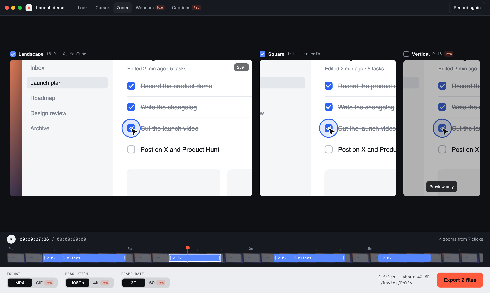

# Dolly

A screen recorder for macOS and Windows. Stop recording and the video is already polished: a zoom on every click, a smooth cursor, a wallpaper with padding. Edit once, see 16:9, 1:1 and 9:16 side by side, and export the shapes you tick.

Runs on Apple silicon Macs with macOS 13.3 or later, and on 64-bit Windows.

## Screenshots



This is a design concept, not the real app. Replace it with real app shots before release.

## Free and Pro

| | Free (MIT, forever) | Pro ($9.99 once) |
|---|---|---|
| Recordings | Unlimited, no time limit | Same |
| Auto-zoom, smooth cursor | Yes | Same |
| Backgrounds and padding | Built-in wallpapers | Plus your own images |
| Shapes | 16:9, 1:1, export together | Plus 9:16 |
| Export | MP4 H.264, up to 1080p, 30 fps | Plus 4K, 60 fps, GIF |
| Watermark | None | None |
| Webcam bubble | Shown, locked | Yes |
| Captions | Shown, locked | Yes, on-device |
| Devices | n/a | 3 per key |

## Install

Builds are unsigned, so both systems warn you the first time. Download the installer from the GitHub release.

### macOS

Open the `.dmg` and drag Dolly to Applications. macOS will refuse to open it at first. Do one of these:

- Run `xattr -cr /Applications/Dolly.app` in Terminal, then open Dolly.
- Try to open Dolly, then go to System Settings, Privacy & Security, and click Open Anyway.

Dolly asks for Screen Recording, Input Monitoring, Microphone and Camera. It doesn't ask for Accessibility.

Input Monitoring is how macOS lets an app see mouse clicks in other apps, which is what puts a zoom on each click. The macOS prompt talks about keystrokes because the same permission covers the keyboard, but Dolly's capture helper only asks for mouse movement and clicks, so it never sees what you type. Say no and Dolly still records, with a cursor path but no automatic zooms.

The app has an ad-hoc signature, so macOS can treat each new version as a different app. After an update, permissions may stop working even though Dolly still looks ticked in System Settings. If that happens, remove Dolly from the list, add it again, and restart Dolly.

### Windows

Run the `.exe`. If SmartScreen says it protected your PC, click More info, then Run anyway. Windows asks for microphone and camera access only.

## Build from source

You need Node 22 and CMake, plus:

- macOS: Xcode Command Line Tools
- Windows: Visual Studio with the C++ desktop tools

```sh
npm ci
npm run build:native
npm run dev
```

`build:native` compiles the capture helper and whisper.cpp, and downloads the Whisper model (148 MB) once. Nothing else is downloaded at build time beyond npm packages.

To make an installer, run `npm run dist:mac` or `npm run dist:win`. Each one must run on its own OS. The result lands in `release/`.

Pushing a `v*` tag that matches the version in `package.json` builds both installers in GitHub Actions and attaches them to a release.

## Privacy

Dolly has no account, telemetry, analytics, crash upload or auto-update. Your recordings stay on your computer. Captions run on your computer with no network.

The app's only network request is the license check, sent once when you enter a Pro key. It carries the key and a hashed device ID. Every other request is blocked.

## Rate limiting the license endpoint

`/api/validate` has no store, so it can't count requests itself. Vercel Firewall has to do it. Before the first release, add a custom rule in the project's Firewall settings and publish it:

- If: Request Path equals `/api/validate`, and Method equals `POST`
- Then: Rate Limit, fixed window, 10 requests per 60 seconds, keyed on IP, answering 429

Ten a minute is plenty for someone typing a key, and it stops anyone guessing keys through your Whop API quota. When the limit is hit, the app tells the user there have been too many attempts and to wait a minute, rather than saying they're offline.

## License

Dolly is MIT, see [LICENSE](LICENSE).

The installers include FFmpeg, which is GPL and runs as a separate program. FFmpeg's license and where to get its source are in [LICENSES/](LICENSES/README.md), along with the licenses of the other bundled components.
